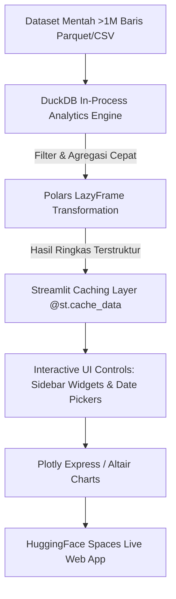

# Dokumen Arsitektur & Pitch Proposal Produk Data (Phase 1)

**Mata Kuliah:** Analisis Big Data  
**Target Check-in:** Pertemuan 10 (Diumumkan Pertemuan 8, repositori dibagikan Pertemuan 9)  
**Nama Tim:** [Tuliskan Nama Tim]  
**Topik / Judul Produk Data:** [Dashboard Analisis Sentimen]  

---

## 1. Problem Statement & Sasaran Pengguna (The Pitch)

### 1.1 Latar Belakang Masalah
*Media sosial menghasilkan jutaan opini tentang merek, produk, dan topik dimana jika membacanya satu per satu sangat tidak memungkinkan. Maka dari itu, dibutuhkan cara meringkas berapa banyak opini yang muncul, kapan, dan bernada apa. Untuk mempermudah dalam menganalisis suatu opini, maka dibuat dashboard interaktif. Dashboard tersebut diperlukan karena pertanyaan analisis yang berubah-ubah.*

### 1.2 Target Pengguna (Target Audience)
*Yang menjadi target pengguna produk data ini adalah Analis media sosial ataupun pemasaran dan peneliti yang berfokus pada bidang NLP yang ingin menilai kualitas label hasil distant supervision dan perilaku model sederhana pada data berskala besar.*

### 1.3 Nilai Tambah & Wawasan Utama
*Setelah berinteraksi, pengguna dapat: 1. Melihat tren volume tweet dan proporsi sentimen per hari/jam, serta hari dengan volume tak biasa; 2. Melihat kata ataupun frasa yang paling membedakan antara tweet positif dan negatif.; 3. Melihat performa model pada set uji manual dan kapan prediksi tidak bisa dipercaya.*

---

## 2. Sumber Dataset & Skala Data

| Parameter | Keterangan |
|-----------|------------|
| **Nama Dataset** | [Sentiment140 (Go, Bhayani, Huang; Stanford, 2009)] |
| **Sumber Resmi** | [Situs: http://help.sentiment140.com/home · File: https://cs.stanford.edu/people/alecmgo/trainingandtestdata.zip · Mirror: https://huggingface.co/datasets/stanfordnlp/sentiment140] |
| **Format Awal** | [CSV] |
| **Ukuran Data** | [1.600.000 baris] |
| **Dimensi Waktu / Temporal** | [Bulan April - Juni tahun 2009] |
| **Fitur / Kolom Kunci** | [text (isi tweet), label (dari polarity: 0 negatif, 4 positif → 0/1), posted_at (dari date), tweet_id, username] |

---

## 3. Diagram Arsitektur Data & Aliran Informasi

Gambarkan alur bagaimana data mengalir dari disk mentah hingga ke antarmuka pengguna:

---

## 4. Rencana Pemrosesan Data & Strategi Caching

### 4.1 Peran DuckDB (SQL Engine)
- Bagaimana data dibaca? (Contoh: pembacaan langsung direktori file Parquet berpartisi temporal).
- Operasi analitik berat apa yang didelegasikan ke DuckDB? (Contoh: `SUMMARIZE`, window function running total, agregasi bulanan/wilayah).

### 4.2 Peran Polars (Transformasi Data)
- Operasi apa yang dilakukan di Polars? (Contoh: pembuatan fitur lag, moving average, dekomposisi temporal, atau pivoting).

### 4.3 Strategi Optimasi Memori & Caching Streamlit
- Bagaimana mencegah aplikasi reload lambat saat pengguna mengubah filter? (Gunakan `@st.cache_data` pada fungsi kueri berat).
- Batas memori cloud HuggingFace Spaces gratis adalah 16GB RAM; pastikan tidak menyimpan dataset mentah 1 juta baris langsung di memori Streamlit session state!

---

## 5. Rencana Tampilan Dashboard (Wireframe & Fitur UI)

1. **Header & Key Metrics KPI:**
   - 4 Kartu metrik ringkasan (Total data, rata-rata, rekor ekstrem, tren persentase).
2. **Filter Interaktif (Sidebar):**
   - Pemilihan stasiun/wilayah, slider rentang tanggal, filter kategori.
3. **Panel Visualisasi Utama:**
   - **Tab 1 — Tren Temporal:** Line chart interaktif dengan range slider dan moving average.
   - **Tab 2 — Analisis Distribusi & Anomali:** Box plot dan deteksi pencilan.
   - **Tab 3 — Peta Wilayah / Spasial:** Choropleth map sebaran provinsi atau scatter map koordinat stasiun.
   - **Tab 4 — Tabel Data Detail:** Tampilan cuplikan data terfilter dengan opsi download ringkasan CSV.

---

## 6. Pembagian Tugas & Tanggung Jawab Anggota Tim

| Anggota Tim | Tanggung Jawab Utama di Phase 1 - 4 |
|-------------|-------------------------------------|
| Mahasiswa 1 | Desain arsitektur, data pipeline, dan integrasi Dockerfile |
| Mahasiswa 2 | Penyusunan kueri analitik DuckDB dan optimasi partisi Parquet |
| Mahasiswa 3 | Desain antarmuka Streamlit, visualisasi Plotly, dan deployment ke HF Spaces |
